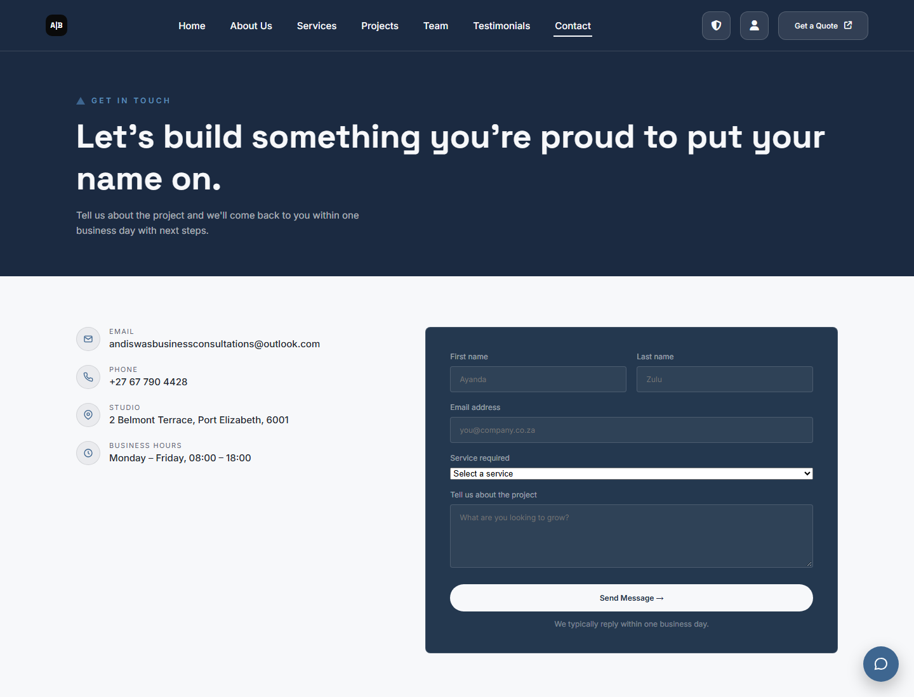
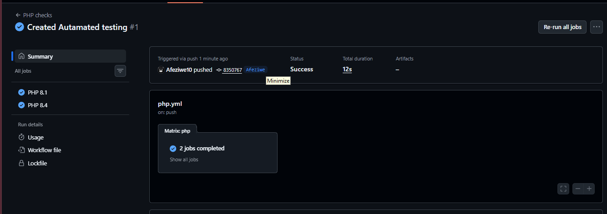

# Andiswa Business Consultation website (XAMPP + MySQL, Azure-ready)

The website and mobile app API share the `andiswa_business` MySQL database. Admins can manage website/app settings and quotes, and clients can track projects and updates.

## Why XAMPP?

This project includes PHP pages and a MySQL database, so it needs a web server that can execute PHP and connect to MySQL. XAMPP bundles Apache, PHP, MySQL/MariaDB, and phpMyAdmin into one local setup. Apache runs pages such as `contact.php` and `admin.php`, while MySQL stores quote requests, accounts, projects, and shared site settings. phpMyAdmin makes it easier to import and inspect the database.

XAMPP lets you develop and test the full website locally without deploying it to a public server. Opening the files directly or using a static-only preview will not run the PHP features. XAMPP is intended here for local development; production hosting should use a properly secured web server and database.

## Website screenshots

| Home page | Contact page |
|---|---|
|  |  |

## GitHub Actions screenshot

The workflow automatically checks PHP 8.1 and PHP 8.4. This screenshot shows a successful run with both matrix jobs passing:



## Features

- PHP session-based admin and client login, with password hashing and CSRF protection.
- Quote requests from the website and mobile app, labelled by source in the admin dashboard.
- Client accounts and temporary passwords generated when quotes are accepted.
- Shared business details and social links for the website and mobile app.
- Chatbot message logging and an upgrade-safe database setup.
- Contact enquiries and client login credentials are sent through PHPMailer over SMTP.

## Project structure

```text
.
|-- .github/
|   `-- workflows/
|       `-- php.yml                 # GitHub Actions PHP checks
|-- assets/
|   |-- screenshots/                # Website and workflow screenshots
|   `-- andiswa-branding.jpg
|-- Projects_Images/
|   |-- AB_Logo/
|   |-- branding/
|   |-- flyers/
|   |-- posters/
|   `-- social-media/
|-- Projects_Js/                     # JavaScript for portfolio and shared UI
|-- Project_Styles/                  # Portfolio stylesheets
|-- about.html
|-- about.css
|-- about.js
|-- admin.php                        # Admin dashboard and quote acceptance
|-- contact.html
|-- contact.php                      # Contact page backend
|-- config.php                       # Database and SMTP helpers
|-- config.local.example.php         # Example local database settings
|-- config.smtp.local.example.php    # Example SMTP settings
|-- dashboard.php                    # Client dashboard
|-- database.sql                     # Base MySQL schema
|-- db_upgrade.php                   # Database upgrade helper
|-- index.html                       # Website home page
|-- login.php
|-- logout.php
|-- composer.json                    # PHP dependency requirements
|-- composer.lock                    # Locked dependency versions
|-- README.md
|-- README_XAMPP.md
|-- setup.php                        # Initial database/admin setup
|-- site_settings.php                # Shared website settings endpoint
|-- submit_quote.php                 # Quote/contact form handler
|-- andiswa_business_azure.sql       # Azure database schema
|-- azure_additions.sql              # Azure database updates
`-- AZURE_SETUP_GUIDE.md
```

Composer creates the ignored `vendor/` directory when you run `composer install`. Local secret files such as `config.local.php` and `config.smtp.local.php` are intentionally not tracked; create them from their corresponding `.example.php` templates when needed. The `Projects_Images/`, `Projects_Js/`, and `Project_Styles/` directories contain the portfolio project media, scripts, and styles.

## Run locally with XAMPP

1. Install XAMPP and Composer. Start Apache and MySQL.
2. Copy this project folder into `C:\xampp\htdocs\`.
3. In a terminal opened in the project folder, run `composer install` to install the locked PHPMailer dependency.
4. Open `http://localhost/phpmyadmin` and import `database.sql`, or open `setup.php` to create/upgrade the database and initialize the admin account.
5. Delete `setup.php` after setup.
6. Open the website at `http://localhost/<project-folder>/index.html`.

By default, the site connects to local MySQL as `root` with no password. For custom local settings or Azure, see the configuration section below.

## Automated checks on GitHub

GitHub Actions runs the PHP checks in `.github/workflows/php.yml` on every push and pull request, and can also be started manually from the repository's **Actions** tab. It checks PHP 8.1 and 8.4, validates the Composer files, installs the locked dependencies, and checks the syntax of project PHP files.

These are automated build and syntax checks, not a full end-to-end test suite: they do not connect to MySQL, send email, or exercise browser flows. SMTP secrets are not needed by the workflow. Add application-level tests separately as the project gains test coverage.

## PHPMailer email guide

### What PHPMailer does in this project

[PHPMailer](https://github.com/PHPMailer/PHPMailer) is the PHP library this website uses to compose and send email. The website connects directly to the configured SMTP provider, authenticates with its mail account, negotiates an encrypted connection, and submits the message for delivery. This project uses Gmail SMTP; it does not use PHP's built-in `mail()` function or the Gmail API.

There are two email flows:

1. **Contact enquiries:** `submit_quote.php` validates the form and saves the enquiry to MySQL. It then emails the business address configured in **Admin → Website & App**. The visitor is set as Reply-To, so the team can reply to the enquiry.
2. **Client login details:** when an admin accepts a quote in `admin.php`, the application creates or refreshes the client's temporary password and commits the account to MySQL. It then emails the username, temporary password, and login URL to the client's quote email address. The client must change the temporary password after logging in.

Email is sent after the database update. If sending fails, the quote/account remains saved; the admin page reports the failure and displays the generated credentials once so they can be provided to the client. There is no fallback to PHP `mail()`.

### Requirements

- PHP 8.1 or later with the OpenSSL extension enabled.
- Composer and the project's PHPMailer dependency installed.
- An SMTP account authorized to send email. For Gmail, use a Google App Password, not the account's normal password.
- The running web server must be able to make an outbound connection to the SMTP host and port.

### Install PHPMailer

Open a terminal in the same project directory that your web server serves and run:

```powershell
composer install
```

Composer reads `composer.lock` and installs the pinned version under `vendor/`. The application loads it from `vendor/autoload.php`. If that file is missing, email sending cannot work. Do not add the `vendor/` directory to Git; another machine or deployment should run `composer install`.

### Set up a Gmail App Password

1. Sign in to the Google account that should send the messages.
2. Enable **2-Step Verification** for that account if it is not already enabled.
3. Open the Google Account's **Security** settings and create an **App Password**. Google may require you to sign in again.
4. Copy the generated App Password. It is a separate credential from your normal Gmail password. Do not share it, paste it into source code, or commit it to Git.

App Password availability depends on Google's account and security policies. If Google does not offer this option for the account, use an SMTP provider that supports authenticated SMTP or configure an organization-approved email service.

### Configure the local secret file

The application looks for `config.smtp.local.php` beside `config.php`. A safe template is provided as `config.smtp.local.example.php`. If the local file does not exist, create it from the template:

```powershell
Copy-Item config.smtp.local.example.php config.smtp.local.php
```

Edit `config.smtp.local.php` and fill in these values:

```php
<?php

return [
    'host' => 'smtp.gmail.com',
    'port' => 465,
    'username' => 'your-address@gmail.com',
    'password' => 'your-google-app-password',
    'encryption' => 'ssl',
    'from_email' => 'your-address@gmail.com',
    'from_name' => 'Andiswa Business Consultation',
];
```

- `host`: Gmail's SMTP server, `smtp.gmail.com`.
- `port` and `encryption`: this setup uses port `465` with implicit SSL. Port `587` with `tls` is also supported if your network allows it.
- `username`: the full Gmail address used to authenticate.
- `password`: the Google App Password. Do not use the normal Gmail password.
- `from_email`: a sender address authorized by the provider. For Gmail, use the authenticated Gmail address.
- `from_name`: the sender name recipients see.

The real `config.smtp.local.php` file is excluded from Git. Keep it beside the `config.php` used by the active web server, and never replace it with a version containing real credentials in a tracked/example file. Apache/PHP environment variables named `SMTP_HOST`, `SMTP_PORT`, `SMTP_USERNAME`, `SMTP_PASSWORD`, `SMTP_ENCRYPTION`, `SMTP_FROM_EMAIL`, and `SMTP_FROM_NAME` override the corresponding local-file values.

### Run and test with XAMPP

1. Start **Apache** and **MySQL** in the XAMPP Control Panel.
2. Confirm the browser URL points to the intended project copy under `C:\xampp\htdocs\`.
3. In that exact project directory, run `composer install` and create/fill `config.smtp.local.php`. The web-served directory must contain `config.php`, `vendor\autoload.php`, and `config.smtp.local.php` together.
4. Open the contact page, submit a real test enquiry using an email address you can access, and check that it arrives at the business email configured in **Admin → Website & App**. Reply to the message to verify the visitor address is used as Reply-To.
5. To test client credentials, submit a test quote using an inbox you control, sign in as an admin, and accept the quote. Verify that the login-details email arrives and that the client can sign in and change the temporary password.
6. Check the recipient's spam/junk folder as well as the inbox. A successful SMTP submission means the provider accepted the message; it cannot guarantee the recipient's provider places it in the inbox.

### Troubleshooting

- **The admin says “Email was not sent”:** confirm the active project copy has all three files (`config.php`, `vendor\autoload.php`, and `config.smtp.local.php`). A second or older copy under `htdocs` will not automatically use files from the repository workspace.
- **Authentication is rejected:** create a new Google App Password, check that `username` is the full Gmail address, and use the App Password rather than the normal account password. If an App Password has been exposed, revoke it and create a replacement.
- **Connection times out or has no SMTP response:** check outbound firewall/network access to `smtp.gmail.com:465`. Some networks block SMTP or port 587; this project’s local Gmail settings use 465/SSL.
- **Sender is rejected:** set `from_email` to the authenticated Gmail address. Gmail may reject unauthorized From addresses.
- **PHPMailer is missing:** run `composer install` in the active web-served project directory and confirm `vendor\autoload.php` exists there.
- **Find the server-side error:** inspect `C:\xampp\php\logs\php_error_log` for entries starting with `SMTP email could not be sent`. Do not enable public SMTP debug output or put passwords into logs.

For production, store SMTP credentials in the hosting platform's secret/environment configuration rather than a file deployed with the application. Rotate an App Password immediately if it may have been shared or committed.

## Run with Azure

1. Follow [AZURE_SETUP_GUIDE.md](./AZURE_SETUP_GUIDE.md).
2. Copy `config.local.example.php` to `config.local.php` and enter the Azure database settings.
3. Place the Azure CA certificate `DigiCertGlobalRootG2.crt.pem` in the project folder, as described in the guide.
4. Upgrade/import the database before running the updated mobile app API.

`config.local.php`, `config.smtp.local.php`, and `*.pem` files are excluded from Git. The site also supports database and SMTP settings supplied through environment variables.

## Quote and client workflow

1. A visitor submits a quote request from the website or mobile app.
2. An admin reviews and accepts the quote.
3. The site creates or updates the client account and emails temporary login credentials.
4. The client logs in, changes the temporary password, and views projects and progress updates.
5. The admin creates projects and posts updates for the client.

## Security and setup notes

- Passwords are stored with `password_hash()` and checked with `password_verify()`.
- Forms use CSRF tokens and database queries use prepared statements.
- Never upload `config.local.php` or database credentials to GitHub.
- Delete `setup.php` after initial setup.
